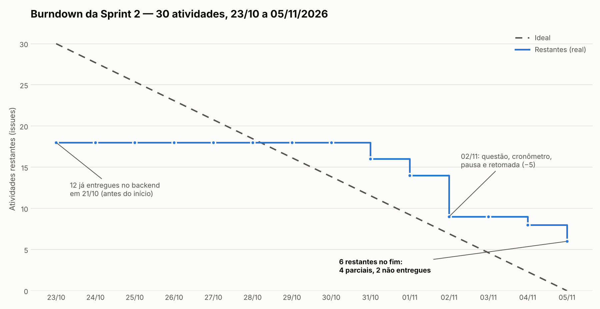

# Burndown da Sprint 2

Sprint 2: 23/10 a 05/11/2026, com 30 atividades no [milestone da Sprint 2](https://github.com/Tech0wl-2026/ABP-Tech0wl/milestone/2). No fim da sprint, **24 atividades foram entregues e 6 ficaram pendentes** (4 parciais e 2 não entregues).

## Como o gráfico foi montado

As 30 issues da Sprint 2 continuam abertas no GitHub, então um burndown feito pelas issues fecharia a sprint em 30, sem queda. Para mostrar o andamento real, cada atividade foi conferida contra o repositório: a data de entrega é a do commit que trouxe a evidência, e a atividade só conta como concluída quando está **Entregue**. As parciais seguem contando como restantes.

- **Linha ideal:** queda linear de 30 em 23/10 até 0 em 05/11.
- **Restantes (real):** atividades ainda não entregues no fim de cada dia.
- **12 atividades de backend** (API, banco e testes) foram entregues em 21/10, junto com o backend do portal, antes do início da sprint. Por isso a linha real começa em 18.
- Dados do gráfico: [burndown-sprint-2.csv](burndown-sprint-2.csv). Revisão por atividade: [entregas-sprint-2.csv](entregas-sprint-2.csv).

## Leitura

- De 23/10 a 30/10 a linha real ficou parada em 18. Nesse período o trabalho foi o protótipo de login e cadastro em HTML/CSS e as apostilas, que ainda não fechavam nenhuma atividade da sprint.
- As entregas se concentraram entre 31/10 e 02/11, com 9 atividades em três dias. Em 02/11 entraram a tela de questão, o cronômetro, a pausa e a retomada.
- A sprint terminou acima da linha ideal: 6 restantes contra 0 planejado.

## Revisão das entregas

| Issue | Atividade | Situação | Data | Evidência | Commit |
|---|---|---|---|---|---|
| [#14](https://github.com/Tech0wl-2026/ABP-Tech0wl/issues/14) | Persistência e validação do cadastro | Entregue | 21/10 | [candidatos.js](../../../backend/src/services/candidatos.js) | [`5b34f3d`](https://github.com/Tech0wl-2026/ABP-Tech0wl/commit/5b34f3d) |
| [#19](https://github.com/Tech0wl-2026/ABP-Tech0wl/issues/19) | Autenticação com CPF e senha | Entregue | 21/10 | [candidatos.js](../../../backend/src/services/candidatos.js) | [`5b34f3d`](https://github.com/Tech0wl-2026/ABP-Tech0wl/commit/5b34f3d) |
| [#20](https://github.com/Tech0wl-2026/ABP-Tech0wl/issues/20) | Consulta dos 12 temas | Entregue | 21/10 | [index.js](../../../backend/src/routes/index.js) | [`5b34f3d`](https://github.com/Tech0wl-2026/ABP-Tech0wl/commit/5b34f3d) |
| [#25](https://github.com/Tech0wl-2026/ABP-Tech0wl/issues/25) | Sorteio de uma questão entre quatro por tema | Entregue | 21/10 | [avaliacao.js](../../../backend/src/services/avaliacao.js) | [`5b34f3d`](https://github.com/Tech0wl-2026/ABP-Tech0wl/commit/5b34f3d) |
| [#32](https://github.com/Tech0wl-2026/ABP-Tech0wl/issues/32) | Imagem e quatro alternativas com uma correta | Entregue | 21/10 | [conteudo.test.js](../../../backend/test/conteudo.test.js) | [`5b34f3d`](https://github.com/Tech0wl-2026/ABP-Tech0wl/commit/5b34f3d) |
| [#35](https://github.com/Tech0wl-2026/ABP-Tech0wl/issues/35) | Alternativa correta após encerrar a questão | Entregue | 21/10 | [avaliacao.js](../../../backend/src/services/avaliacao.js) | [`5b34f3d`](https://github.com/Tech0wl-2026/ABP-Tech0wl/commit/5b34f3d) |
| [#36](https://github.com/Tech0wl-2026/ABP-Tech0wl/issues/36) | Persistir respostas e estado da certificação | Entregue | 21/10 | [avaliacao.js](../../../backend/src/services/avaliacao.js) | [`5b34f3d`](https://github.com/Tech0wl-2026/ABP-Tech0wl/commit/5b34f3d) |
| [#40](https://github.com/Tech0wl-2026/ABP-Tech0wl/issues/40) | Encerrar questão ao esgotar o tempo | Entregue | 21/10 | [avaliacao.js](../../../backend/src/services/avaliacao.js) | [`5b34f3d`](https://github.com/Tech0wl-2026/ABP-Tech0wl/commit/5b34f3d) |
| [#42](https://github.com/Tech0wl-2026/ABP-Tech0wl/issues/42) | Persistir a retomada pelo próximo tema | Entregue | 21/10 | [avaliacao.js](../../../backend/src/services/avaliacao.js) | [`5b34f3d`](https://github.com/Tech0wl-2026/ABP-Tech0wl/commit/5b34f3d) |
| [#45](https://github.com/Tech0wl-2026/ABP-Tech0wl/issues/45) | Impedir nova resposta a tema encerrado | Entregue | 21/10 | [api.test.js](../../../backend/test/api.test.js) | [`5b34f3d`](https://github.com/Tech0wl-2026/ABP-Tech0wl/commit/5b34f3d) |
| [#65](https://github.com/Tech0wl-2026/ABP-Tech0wl/issues/65) | Histórico completo de respostas | Entregue | 21/10 | [index.js](../../../backend/src/routes/index.js) | [`5b34f3d`](https://github.com/Tech0wl-2026/ABP-Tech0wl/commit/5b34f3d) |
| [#91](https://github.com/Tech0wl-2026/ABP-Tech0wl/issues/91) | 48 questões com imagens e alternativas | Entregue | 21/10 | [questoes.json](../../../database/servidor/questoes.json) | [`5b34f3d`](https://github.com/Tech0wl-2026/ABP-Tech0wl/commit/5b34f3d) |
| [#2](https://github.com/Tech0wl-2026/ABP-Tech0wl/issues/2) | Página inicial e instruções da certificação | Entregue | 31/10 | [home.html](../../../frontend/home.html) | [`3e7d8a9`](https://github.com/Tech0wl-2026/ABP-Tech0wl/commit/3e7d8a9) |
| [#10](https://github.com/Tech0wl-2026/ABP-Tech0wl/issues/10) | Formulário de cadastro | Entregue | 31/10 | [cadastro.html](../../../frontend/cadastro.html) | [`1d86832`](https://github.com/Tech0wl-2026/ABP-Tech0wl/commit/1d86832) |
| [#28](https://github.com/Tech0wl-2026/ABP-Tech0wl/issues/28) | Listagem dos temas para estudo | Entregue | 01/11 | [curso-portal.html](../../../frontend/curso-portal.html) | [`c659b26`](https://github.com/Tech0wl-2026/ABP-Tech0wl/commit/c659b26) |
| [#29](https://github.com/Tech0wl-2026/ABP-Tech0wl/issues/29) | Conteúdo didático por tema | Entregue | 01/11 | [material.html](../../../frontend/material.html) | [`5089a0e`](https://github.com/Tech0wl-2026/ABP-Tech0wl/commit/5089a0e) |
| [#6](https://github.com/Tech0wl-2026/ABP-Tech0wl/issues/6) | Ações de iniciar e retornar à certificação | Entregue | 02/11 | [home.html](../../../frontend/home.html) | [`d0cc187`](https://github.com/Tech0wl-2026/ABP-Tech0wl/commit/d0cc187) |
| [#21](https://github.com/Tech0wl-2026/ABP-Tech0wl/issues/21) | Tela reutilizável de questão | Entregue | 02/11 | [questao.html](../../../frontend/questao.html) | [`3d4d1c1`](https://github.com/Tech0wl-2026/ABP-Tech0wl/commit/3d4d1c1) |
| [#39](https://github.com/Tech0wl-2026/ABP-Tech0wl/issues/39) | Cronômetro regressivo de 150 segundos | Entregue | 02/11 | [questao.html](../../../frontend/questao.html) | [`3d4d1c1`](https://github.com/Tech0wl-2026/ABP-Tech0wl/commit/3d4d1c1) |
| [#41](https://github.com/Tech0wl-2026/ABP-Tech0wl/issues/41) | Continuar ou encerrar após cada resposta | Entregue | 02/11 | [questao.html](../../../frontend/questao.html) | [`d0cc187`](https://github.com/Tech0wl-2026/ABP-Tech0wl/commit/d0cc187) |
| [#43](https://github.com/Tech0wl-2026/ABP-Tech0wl/issues/43) | Interface de interrupção e retomada | Entregue | 02/11 | [home.html](../../../frontend/home.html) | [`d0cc187`](https://github.com/Tech0wl-2026/ABP-Tech0wl/commit/d0cc187) |
| [#15](https://github.com/Tech0wl-2026/ABP-Tech0wl/issues/15) | Formulário de login com CPF e senha | Entregue | 04/11 | [login.js](../../../frontend/src/js/login.js) | [`b0b0a00`](https://github.com/Tech0wl-2026/ABP-Tech0wl/commit/b0b0a00) |
| [#88](https://github.com/Tech0wl-2026/ABP-Tech0wl/issues/88) | Docker Compose com aplicação e PostgreSQL | Entregue | 05/11 | [compose.yaml](../../../compose.yaml) | [`0264be3`](https://github.com/Tech0wl-2026/ABP-Tech0wl/commit/0264be3) |
| [#96](https://github.com/Tech0wl-2026/ABP-Tech0wl/issues/96) | Validar jornada inicial, cadastro e login | Entregue | 05/11 | [frontend.spec.mjs](../../../testes/frontend.spec.mjs) | [`b80c5db`](https://github.com/Tech0wl-2026/ABP-Tech0wl/commit/b80c5db) |
| [#33](https://github.com/Tech0wl-2026/ABP-Tech0wl/issues/33) | Feedback da resposta e ações de continuidade | Parcial | — | [questao.html](../../../frontend/questao.html) | — |
| [#76](https://github.com/Tech0wl-2026/ABP-Tech0wl/issues/76) | Proteção e minimização de dados pessoais | Parcial | — | [candidatos.js](../../../backend/src/services/candidatos.js) | — |
| [#97](https://github.com/Tech0wl-2026/ABP-Tech0wl/issues/97) | Validar prova, tempo, interrupção e retomada | Parcial | — | [api.test.js](../../../backend/test/api.test.js) | — |
| [#100](https://github.com/Tech0wl-2026/ABP-Tech0wl/issues/100) | Revisar questões, imagens e material didático | Parcial | — | [questoes.md](../../conteudo/questoes.md) | — |
| [#44](https://github.com/Tech0wl-2026/ABP-Tech0wl/issues/44) | Encerrar a questão em perda de conexão | Não entregue | — | — | — |
| [#46](https://github.com/Tech0wl-2026/ABP-Tech0wl/issues/46) | Bloquear repetição também na interface | Não entregue | — | — | — |

## Pendências para a Sprint 3

| Issue | O que falta |
|---|---|
| [#33](https://github.com/Tech0wl-2026/ABP-Tech0wl/issues/33) | Mostrar o feedback de acerto ou erro e a alternativa correta depois de cada resposta. |
| [#44](https://github.com/Tech0wl-2026/ABP-Tech0wl/issues/44) | Encerrar a questão quando o candidato perde a conexão ou fecha a página. |
| [#46](https://github.com/Tech0wl-2026/ABP-Tech0wl/issues/46) | Impedir na interface que o candidato responda de novo um tema encerrado. |
| [#76](https://github.com/Tech0wl-2026/ABP-Tech0wl/issues/76) | Proteger os dados nas telas: hoje cadastro e senha ficam no localStorage do navegador. A API já usa bcrypt. |
| [#97](https://github.com/Tech0wl-2026/ABP-Tech0wl/issues/97) | Validar na interface o tempo, a interrupção e a retomada. Os testes da API já cobrem essas regras. |
| [#100](https://github.com/Tech0wl-2026/ABP-Tech0wl/issues/100) | Concluir a revisão pedagógica das 12 questões novas e das imagens. |

Para o burndown da Sprint 3 refletir o Project automaticamente, feche cada issue no GitHub quando a entrega for aceita.
