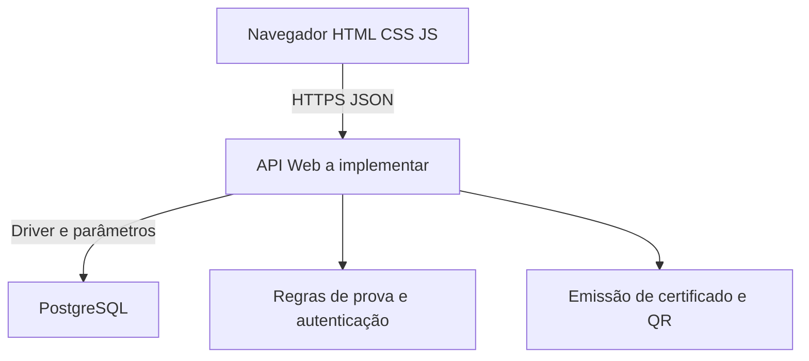

# Arquitetura e limites atuais

## Incremento executável

`frontend/` contém página informativa estática HTML/CSS/JS, servida por Nginx. `database/` contém modelo físico de referência executado no PostgreSQL 17. Docker Compose sobe os dois serviços; **não há comunicação entre a página estática e o banco**, nem backend implementado. Os serviços são independentes neste incremento.

## Arquitetura alvo

A tecnologia do backend é decisão D01 pendente. Não colocar credenciais do banco, gabaritos, cálculo final ou verificação de titularidade no JavaScript do navegador. Cada requisição privada deve vincular o usuário autenticado à tentativa/resultado consultado.

Sorteio, início da janela de 150 segundos, resposta única e encerramento devem ser transações no servidor com bloqueio/controle de concorrência. O DDL reduz inconsistências mas não substitui autenticação, autorização, endpoint, detecção de interrupção ou idempotência. Não reutilizar o usuário dono do schema como credencial pública da aplicação; criar papel com privilégios mínimos ao integrar a API.

As imagens da amostra ficam no frontend; questões reais serão retornadas pela API sem gabarito antes do encerramento. Usar versionamento/migrações para bancos já criados: o schema inicial não é script de atualização.
