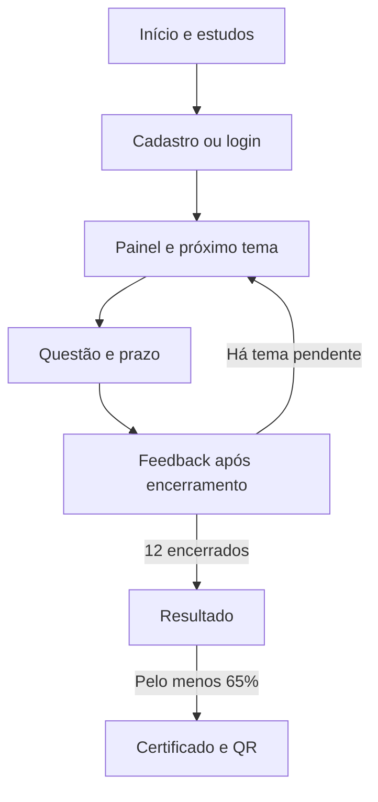
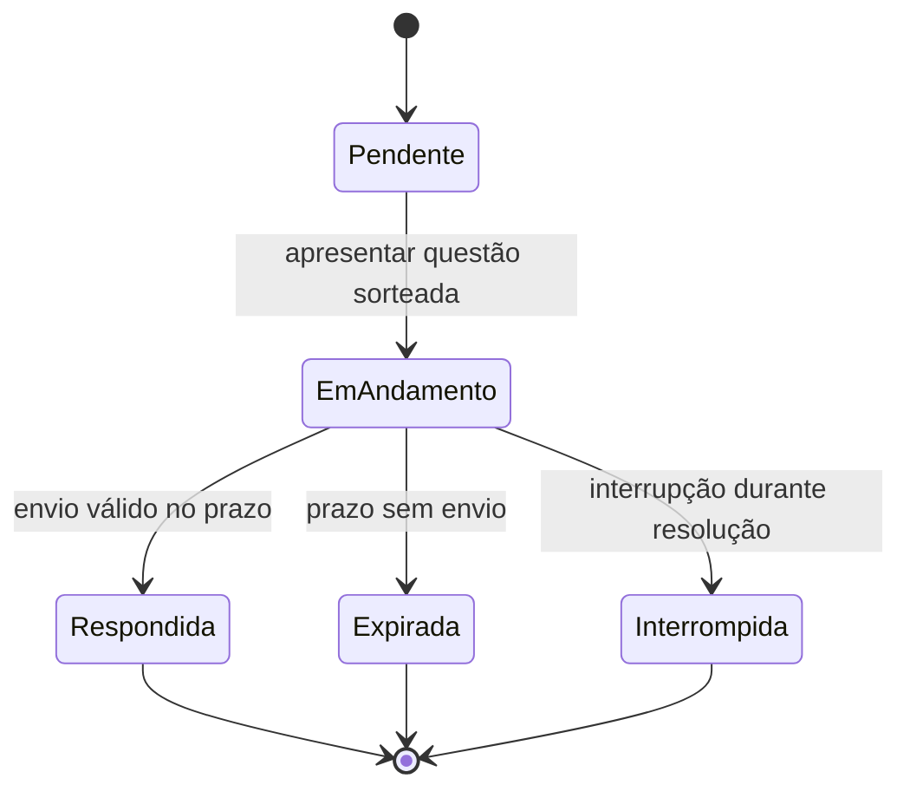

# Fluxo completo de referência — RF01 a RF21

Proposta para implementação no Figma/Astah; não substitui frames navegáveis. Toda tela deve ter versão desktop e mobile relevante, foco visível e mensagens em linguagem simples.

| Tela | Requisitos | Estados e saídas a desenhar |
|---|---|---|
| Início | RF01/RF02 | Descrição, instruções, estudar, iniciar/retornar; visitante e autenticado |
| Cadastro | RF03 | CPF único, nome/e-mail/senha, obrigatórios, CPF inválido/duplicado, erro de rede e sucesso |
| Login | RF04 | CPF/senha, credenciais inválidas sem revelar cadastro, sessão expirada e retorno |
| Estudos | RF07 | 12 temas, conteúdo/imagens/fontes, carregamento e indisponibilidade |
| Painel da certificação | RF02/RF05/RF13/RF21 | Nova, em andamento, pausada, concluída; pendentes/concluídos e retomada |
| Questão | RF06/RF08/RF10/RF15 | Imagem, A/B/C/D, 150s, foco, alternativa selecionada, envio único e espera |
| Feedback | RF09/RF11/RF12 | Correta/incorreta/sem resposta, mostrar correta só após encerramento; continuar ou pausar |
| Interrupção/retomada | RF13/RF14/RF15 | Confirmar saída, perda de rede, navegador fechado, expiração; tema encerrado e próximo pendente |
| Resultado | RF16/RF17 | Só após 12 temas; aprovado ≥65% e reprovado; nota/percentual, sem certificado quando reprovado |
| Certificado e validação pública | RF18/RF19 | Documento privado com campos completos e QR; público válido/inexistente, dados mínimos conforme decisão D06 |
| Histórico/progresso | RF20/RF21 | Todas tentativas, temas, questão e respostas, data/hora; vazio e acesso negado |

## Jornada principal

## Encerramento e retomada

Os estados terminais não voltam à questão. Retomar significa iniciar o próximo tema pendente. O servidor é responsável por validar a situação real; não confiar no relógio do navegador. Para interrupções não detectáveis imediatamente, definir e testar a política D07 antes de concluir o motor.
